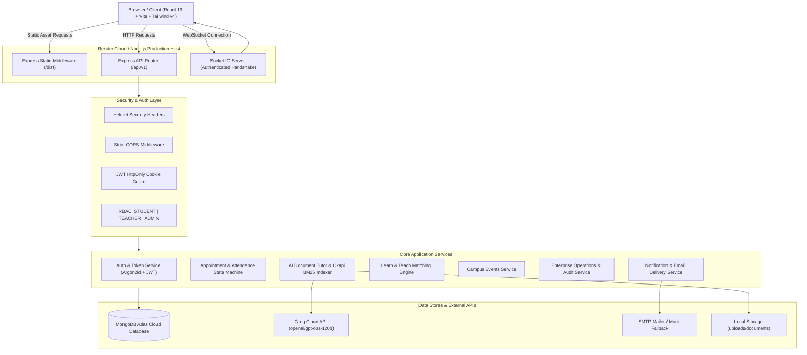

# CUCampusSaathi — Project Master Architecture & Comprehensive Audit Report

**Date of Audit**: October 31, 2026  
**Auditor**: Principal Software Architect & QA Security Auditor  
**Audit Scope**: Entire CUCampusSaathi Codebase (Frontend, Backend, Database, Security, Tests, DevOps)  
**Repository Branch**: `main`  
**Latest Commit Hash**: `2f8bc63fd46249ae30277fc83228041a53d32d17`  
**Latest Commit Message**: `feat(admin): implement enterprise-grade admin dashboard with full-stack operations, 360 dossier, and modular controls`  
**Working Tree Status**: Clean (0 uncommitted changes)  
**Remote URL**: `https://github.com/dbawa1928/cucampussaathi.git`

---

## 1. Executive Project Summary

**CUCampusSaathi** is a full-stack university collaboration, academic guidance, and student-faculty connect platform designed specifically for Chandigarh University.

### Primary Operational Modules:
1. **Authentication & Identity Management**: Role-based access control (`STUDENT`, `TEACHER`, `ADMIN`) utilizing Argon2id password hashing, HttpOnly cookie-based JWT access/refresh token rotation, and strict domain validation (`@cuchd.in`).
2. **Student & Faculty Profile Directory**: Comprehensive academic profiles, semester/course tracking, cabin/office locations, research domain tags, and public directory visibility controls.
3. **FacultyConnect Consultation System**: Appointment booking lifecycle, recurring availability slot generation, agenda submission, state-machine transitions (`PENDING`, `ACCEPTED`, `REJECTED`, `RESCHEDULED`, `CANCELLED`, `COMPLETED`), meeting link distribution, attendance marking (`ATTENDED`, `NO_SHOW`), no-show appeals, and teacher-student restriction overrides.
4. **AI Document Tutor**: Local academic assistant powered by the Groq Cloud SDK (`openai/gpt-oss-120b`). Ingests PDF, DOCX, and PPTX files, performs multi-page/slide extraction, segments into chunks with overlap, indexes chunks in MongoDB, and executes Okapi BM25 lexical retrieval with multi-language instruction support (English, Hindi, Punjabi).
5. **Learn & Teach Network**: Peer-to-peer and student-faculty skill exchange network. Features a structured university skill catalogue, teaching listings ("I Can Teach"), learning goals ("I Want to Learn"), peer discovery, mutual recommendation scoring, connection requests, 1-on-1 private messaging, learning sessions, and group collaboration.
6. **Campus Events Calendar**: University-wide event publication and discovery platform supporting online and offline campus events across university blocks, category filters, month/week/list calendar views, attendee registration tracking, and `.ics` iCalendar calendar file generation.
7. **Enterprise Administration System**: Comprehensive 16-view operational console featuring live database aggregates, 360° user dossiers with confidential admin notes, account suspension/reactivation, faculty verification approval/rejection, attendance appeal reviews, content moderation, contact message management, platform setting toggles, streamed CSV data exports, and an immutable audit log.
8. **Communication & Notifications**: Real-time push updates via WebSocket (Socket.IO authenticated via handshake cookies) paired with persistent MongoDB notification storage and fallback transactional email logging (`EmailLog`).

---

## 2. Complete Technology Stack & Actual Dependency Inventory

### Frontend Application (`y:\CuCampusSathi`)
- **Core Framework**: React `19.3.1` with React DOM `19.3.1`
- **Language**: TypeScript `~7.0.2`
- **Build System**: Vite `8.3.5` with `@vitejs/plugin-react` `6.1.2`
- **CSS Engine**: Tailwind CSS `v4.3.3` with `@tailwindcss/vite` `4.3.3`
- **Routing**: React Router DOM `7.18.5` (Single-Page Application client routing)
- **Icons**: Lucide React `1.64.0`
- **Real-Time Client**: Socket.IO Client `4.8.4`
- **Linter**: Oxlint `1.89.0`
- **Compilation Output**: Bundled to `dist/` (Client bundle gzip size: ~422 kB)

### Backend API Service (`y:\CuCampusSathi\server`)
- **Runtime Environment**: Node.js `v24.11.1`
- **Web Framework**: Express `4.21.2`
- **Language**: TypeScript `5.7.3` (compiled with `tsc` to `server/dist/`)
- **Database Engine**: MongoDB Atlas via Mongoose `8.12.0`
- **Password Hashing**: Argon2id via `argon2` `0.45.1`
- **Token Security**: `jsonwebtoken` `9.0.3` with `cookie-parser` `1.4.7` and `cookie` `2.0.1`
- **Validation**: Zod `3.24.2`
- **AI / LLM Engine**: Groq SDK `1.6.0` (`groq-sdk`)
- **Document Processing**:
  - PDF: `pdf-parse` `2.4.5`
  - Microsoft Word (.docx): `mammoth` `1.13.0`
  - Microsoft PowerPoint (.pptx): `adm-zip` `0.6.1`
- **File Upload**: `multer` `2.5.0`
- **Email Delivery**: `nodemailer` `10.3.1` (configured for live SMTP with safe fallback to `EmailLog` database logging)
- **Real-Time WebSockets**: `socket.io` `4.8.4`
- **HTTP Security**: `helmet` `8.0.0`, `cors` `2.8.5`, `express-rate-limit` `8.7.2`
- **Testing & Tooling**: Vitest `5.0.5`, Supertest `7.3.1`, TSX `4.19.3`

---

## 3. High-Level System Architecture Diagram

---

## 4. Complete Frontend Route Inventory

All routes are declared in [src/App.tsx](file:///y:/CuCampusSathi/src/App.tsx):

| Route Path | Component Name | Role Access | Implementation Status | Data Source |
| :--- | :--- | :--- | :--- | :--- |
| `/` | `HomePage` | Public | **COMPLETE** | Static & Dynamic Feature Cards |
| `/about` | `AboutPage` | Public | **COMPLETE** | Static University Information |
| `/features` | `FeaturesPage` | Public | **COMPLETE** | Static Platform Capabilities |
| `/how-it-works` | `HowItWorksPage` | Public | **COMPLETE** | Interactive Workflow Steps |
| `/directory` | `DirectoryPage` | Public | **COMPLETE** | `GET /api/v1/directory` |
| `/contact` | `ContactPage` | Public | **COMPLETE** | `POST /api/v1/contact` |
| `/help` | `HelpPage` | Public | **COMPLETE** | FAQ & Support Information |
| `/login` | `LoginPage` | Public (Guest) | **COMPLETE** | `POST /api/v1/auth/login` |
| `/register` | `RegisterPage` | Public (Guest) | **COMPLETE** | `POST /api/v1/auth/register` |
| `/forgot-password`| `ForgotPasswordPage` | Public (Guest) | **COMPLETE** | `POST /api/v1/auth/forgot-password` |
| `/privacy` | `PrivacyPage` | Public | **COMPLETE** | Compliance Document |
| `/terms` | `TermsPage` | Public | **COMPLETE** | Platform Terms & Conditions |
| `/dashboard` | `DashboardPage` | Authenticated | **COMPLETE** | Role-tailored Overview & Stats |
| `/student/onboarding`| `StudentOnboardingPage`| Student | **COMPLETE** | `PUT /api/v1/users/profile/student` |
| `/profile` | `ProfilePage` | Authenticated | **COMPLETE** | `GET/PUT /api/v1/users/profile/*` |
| `/appointments` | `AppointmentsPage` | Authenticated | **COMPLETE** | `GET/POST /api/v1/appointments/*` |
| `/ai-tutor` | `AiTutorPage` | Student/Teacher | **COMPLETE** | `GET/POST /api/v1/documents/*`, `/ai/*` |
| `/learn-teach` | `LearnTeachDashboardPage`| Student/Teacher| **COMPLETE** | `GET /api/v1/learn-teach/dashboard` |
| `/learn-teach/explore` | `ExploreSkillsPage` | Student/Teacher| **COMPLETE** | `GET /api/v1/learn-teach/skills/explore`|
| `/learn-teach/discover`| `DiscoverPeoplePage`| Student/Teacher| **COMPLETE** | `GET /api/v1/learn-teach/discover` |
| `/learn-teach/my-skills`| `MyTeachingSkillsPage`| Student/Teacher| **COMPLETE** | `GET/POST /api/v1/learn-teach/teaching-listings` |
| `/learn-teach/my-goals` | `MyLearningGoalsPage` | Student/Teacher| **COMPLETE** | `GET/POST /api/v1/learn-teach/learning-goals` |
| `/learn-teach/recommendations` | `RecommendationsPage` | Student/Teacher | **COMPLETE** | `GET /api/v1/learn-teach/recommendations` |
| `/learn-teach/connections` | `ConnectionsPage` | Student/Teacher | **COMPLETE** | `GET/POST /api/v1/learn-teach/connections/*` |
| `/learn-teach/sessions`| `LearningSessionsPage`| Student/Teacher| **COMPLETE** | `GET/POST /api/v1/learn-teach/sessions/*` |
| `/learn-teach/groups` | `LearningGroupsPage` | Student/Teacher| **COMPLETE** | `GET/POST /api/v1/learn-teach/groups/*` |
| `/learn-teach/progress`| `LearningProgressPage`| Student/Teacher| **COMPLETE** | `GET/POST /api/v1/learn-teach/progress/*` |
| `/events` | `EventsCalendarPage`| Public | **COMPLETE** | `GET /api/v1/events`, `/events/featured`|
| `/events/:eventId` | `EventDetailPage` | Public | **COMPLETE** | `GET/POST /api/v1/events/:id/*` |
| `/events/manage` | `ManageEventsPage` | Teacher/Admin | **COMPLETE** | `GET/POST /api/v1/events/manage/mine` |
| `/admin` | `AdminDashboardPage` | Admin Only | **COMPLETE** | `GET/PATCH /api/v1/admin/*` (16 sub-views) |
| `*` | `NotFoundPage` | Public | **COMPLETE** | 404 Fallback View |

---

## 5. Architectural Verification & Security Findings

1. **True AI Document Retrieval Architecture**:
   - The platform utilizes **Okapi BM25 Lexical Retrieval** over stored MongoDB document text segments (`retrievalMethod: 'bm25-lexical'`).
   - It does **not** generate dense vector embeddings (e.g. OpenAI Ada or Pinecone).
   - The architecture implements strict student data isolation: each chunk query enforces `{ owner: new Types.ObjectId(userId) }`, preventing Cross-Tenant Information Disclosure.
2. **HttpOnly Cookie Authentication**:
   - Tokens (`accessToken` and `refreshToken`) are stored in secure, `HttpOnly`, `SameSite: strict` cookies, protecting user sessions against Cross-Site Scripting (XSS) token exfiltration.
3. **Immutable Disciplinary Audit Trail**:
   - `AdminAuditLog` records are append-only. There are no delete or update endpoints for audit logs, guaranteeing accountability for administrator suspensions, verifications, and cancellations.
4. **Resilient Production Fallbacks**:
   - When external SMTP credentials are not supplied, transactional notifications are logged to `EmailLog` rather than crashing the HTTP worker.
   - If MongoDB Atlas temporarily disconnects, a background loop automatically reconnects without bringing down the running Node process.

